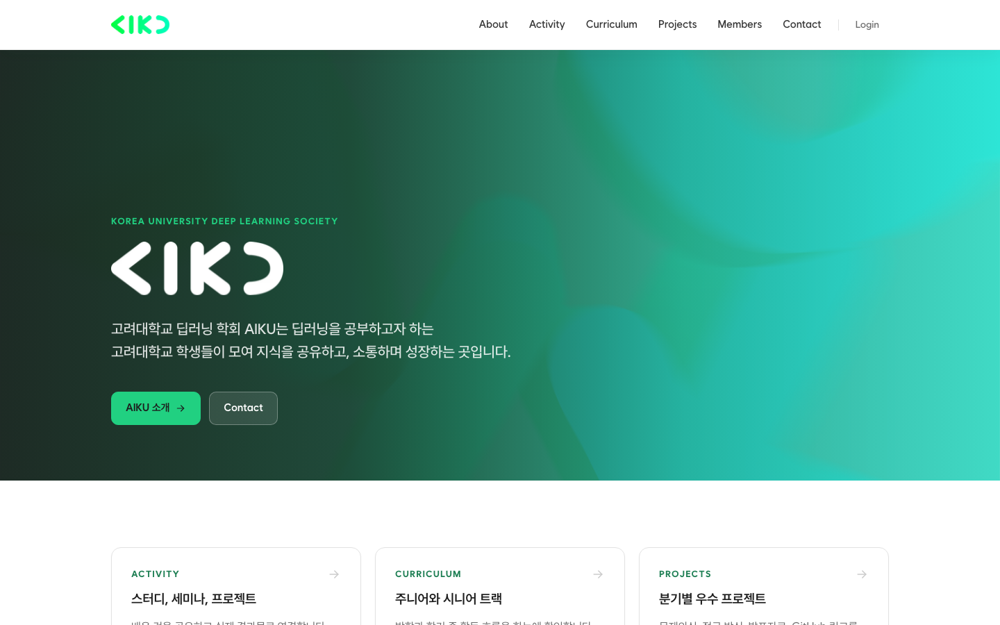
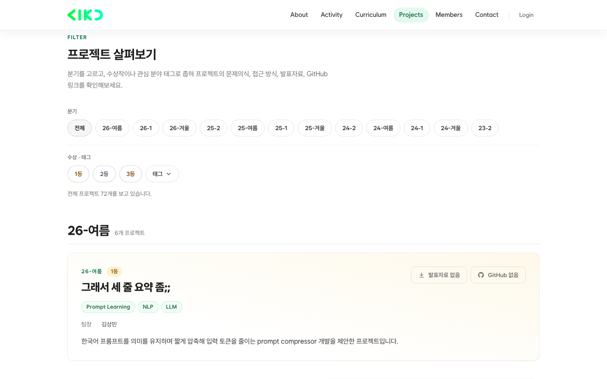
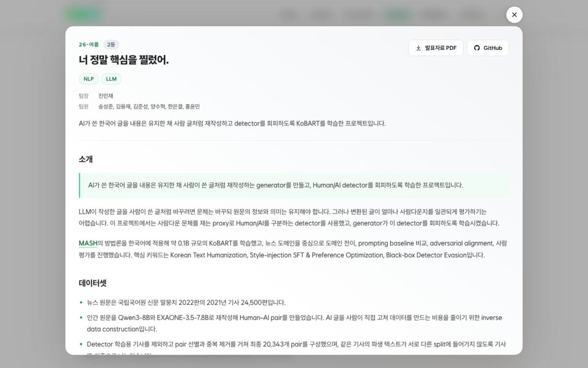
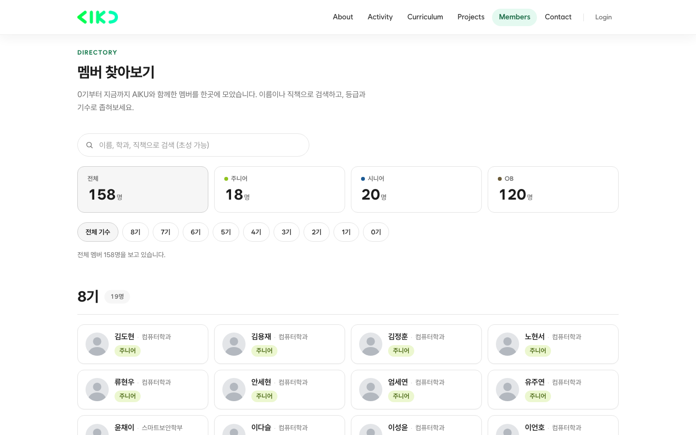
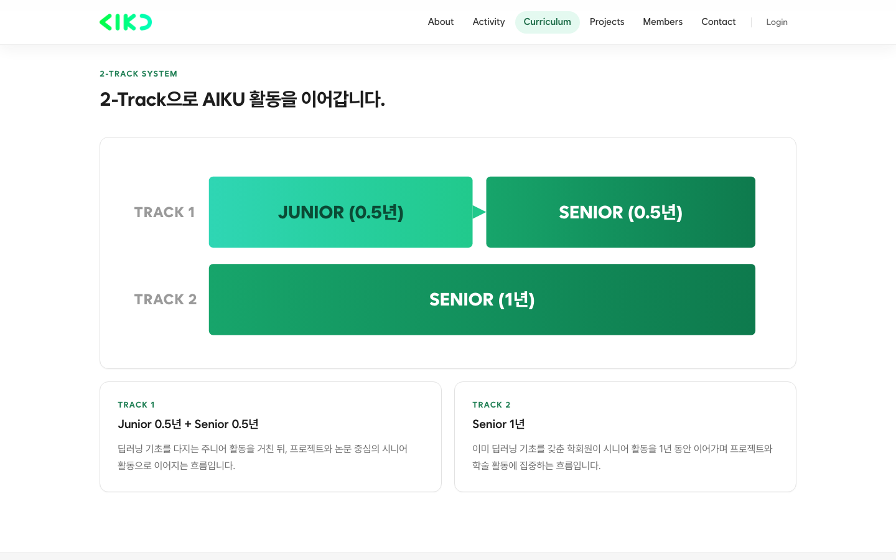
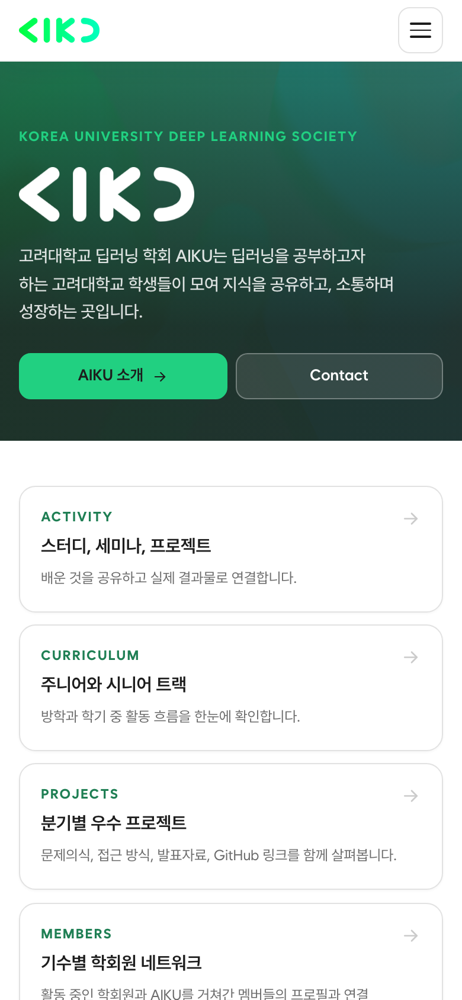
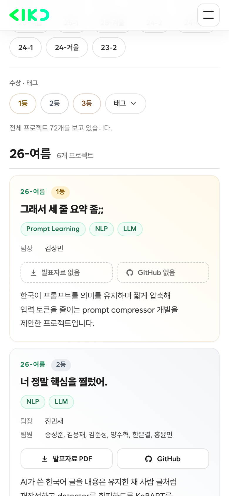
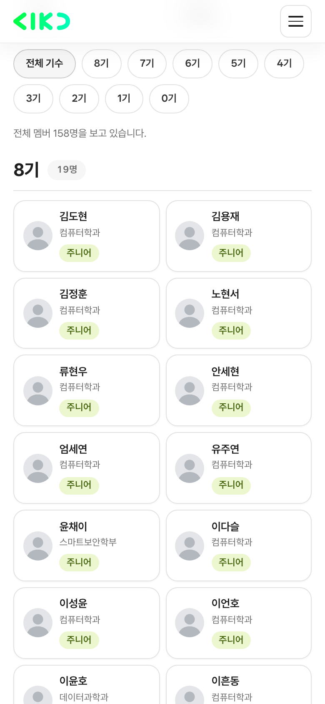

<div align="center">


# AIKU 공식 홈페이지

고려대학교 딥러닝 학회 **AIKU**의 공식 홈페이지입니다.<br />
학회를 소개하는 공개 사이트이자, 회원과 프로젝트를 관리하는 학회 운영 도구입니다.

**[aiku-page.vercel.app](https://aiku-page.vercel.app)**




</div>

## 무엇을 할 수 있나요

| | |
| --- | --- |
| **프로젝트 아카이브** | 2023년부터의 프로젝트를 분기별로 모았습니다. 분기, 수상(1·2·3등), 태그로 걸러 보고, 카드를 누르면 본문이 펼쳐집니다. |
| **Members** | 0기부터 현재까지의 회원 명단입니다. 이름·학과·직책으로 검색하고 등급과 기수로 좁혀 봅니다. |
| **회원 로그인** | AIKU 아이디, Google, GitHub으로 로그인합니다. 이름·기수·학번으로 본인을 확인하며, 어느 방법으로 들어와도 같은 회원으로 연결됩니다. |
| **프로필** | 회원이 자기소개, 링크, 관심 분야, 경력을 직접 쓰고 공개 여부를 정합니다. 참여한 프로젝트는 자동으로 나타납니다. |
| **관리자 페이지** | 운영진이 소식, 프로젝트, 회원 명단, 가입 요청을 관리합니다. |

## 화면

| 프로젝트 목록 | 프로젝트 본문 |
| --- | --- |
|  |  |

| Members | 커리큘럼 |
| --- | --- |
|  |  |

<div align="center">



</div>

## 기술 구성

| 영역 | 사용 기술 |
| --- | --- |
| 웹 | Next.js 16 (App Router, TypeScript), React 19, Tailwind CSS v4 |
| 데이터 | Supabase (Postgres, Storage, Auth) |
| 배포 | Vercel (`main`에 푸시하면 자동 배포) |
| 테스트 | Vitest (단위), Playwright (E2E) |

## 로컬에서 실행하기

필요한 것: Node.js 24, pnpm, Docker Desktop(로컬 Supabase용). 클라우드 계정 없이도 전부 로컬에서 실행할 수 있습니다.

```bash
pnpm install
pnpm db:start                 # 로컬 Supabase 실행 (처음엔 이미지 내려받느라 몇 분 걸림)
cp .env.example .env.local    # 아래 설명대로 값 채우기
pnpm db:reset                 # 마이그레이션과 예시 데이터(supabase/seed.sql) 적용 (DB 초기화)
pnpm dev                      # http://localhost:3000
```

`.env.local` 값은 이렇게 채웁니다.

- `NEXT_PUBLIC_SUPABASE_URL`, `NEXT_PUBLIC_SUPABASE_PUBLISHABLE_KEY`, `SUPABASE_SECRET_KEY`: `pnpm exec supabase status`에 나오는 `API_URL`, `PUBLISHABLE_KEY`, `SECRET_KEY`
- `ADMIN_ID`, `ADMIN_PASSWORD`: 로컬에서 쓸 관리자 계정 (아무 값)
- `SESSION_SECRET`: `openssl rand -base64 48`로 만든 값
- `CRON_SECRET`: `openssl rand -hex 24`로 만든 값

### 자주 쓰는 명령어

| 명령어 | 설명 |
| --- | --- |
| `pnpm dev` | 개발 서버 |
| `pnpm build` / `pnpm start` | 프로덕션 빌드 / 실행 |
| `pnpm lint` / `pnpm typecheck` / `pnpm test` | 린트 / 타입 검사 / 단위 테스트 |
| `pnpm test:e2e` | Playwright 스모크 테스트 (`pnpm build` 후, 로컬 DB와 데이터가 있어야 함) |
| `pnpm db:start` / `pnpm db:stop` | 로컬 Supabase 켜기 / 끄기 (Studio: http://127.0.0.1:54323) |
| `pnpm db:reset` | 로컬 DB를 마이그레이션 기준으로 초기화하고 예시 데이터(`supabase/seed.sql`, 로컬 전용)를 넣기 |
| `pnpm db:types` | DB 스키마에서 TypeScript 타입 재생성 (`src/lib/supabase/database.types.ts`) |
| `pnpm storage:gc [--apply]` | 어디에서도 쓰지 않는 업로드 파일 찾기 / 지우기 |

## 폴더 구조

```text
src/
  app/(public)/        공개 페이지 (about, activities, curriculum, projects, members, contact, profile, privacy)
  app/(admin)/         회원 로그인·회원가입·회원 등록, 관리자 로그인, 관리자 페이지
  app/api/cron/        매일 실행되는 keepalive 작업
  actions/             Server Actions (콘텐츠 저장, 회원 확인과 계정 연결, 프로필, 업로드 URL 발급)
  components/          화면 컴포넌트 (layout, home, projects, members, profile, auth, markdown, admin, ui)
  lib/                 데이터 조회, 인증, 입력 검증, 마크다운 처리, Storage 규칙
  proxy.ts             로그인하지 않은 /admin 접근을 /login/admin으로 보냄
supabase/migrations/   DB 스키마, 정렬 함수, 권한(RLS), Storage 버킷
scripts/               Storage 정리, 노션 프로젝트 가져오기
tests/e2e/             Playwright 스모크 테스트
public/assets/         로고, 파비콘, 배경 이미지
docs/screenshots/      이 문서의 화면 캡처
```

## 데이터 구조

모든 콘텐츠는 Supabase(Postgres)에 정해진 형식으로 들어 있고, 화면에 직접 적어 넣은 내용은 없습니다.

```text
seasons ──< projects ──< project_members >── members >── generations
                                               │
                                               ├── member_profiles      본인이 쓰는 프로필 (공개 여부 선택)
                                               ├── member_student_ids   본인 확인용 학번 해시 (원문은 저장하지 않음)
                                               └── member_accounts >── auth.users   한 회원에 로그인 방법 여러 개
```

| 테이블 | 내용 |
| --- | --- |
| `seasons`, `projects` | 분기와 프로젝트. 제목, 태그, 한 줄 요약, 본문(Markdown), 수상 순위, GitHub 주소, 발표자료(PDF) |
| `project_members` | 프로젝트 참여자와 역할(팀장·팀원). 명단의 회원과 연결되면 그 회원의 프로필에 프로젝트가 나타납니다. |
| `generations`, `members` | 기수와 회원 명단. 이름, 학과, 등급(주니어·시니어·OB), 회장·부회장 직책 |
| `member_profiles` | 회원이 직접 쓰는 소개, 링크, 관심 분야, 경력, 프로필 사진. 공개로 설정한 것만 다른 사람이 볼 수 있습니다. |
| `member_accounts`, `member_signup_requests` | 로그인 계정과 회원의 연결, 본인 확인에 실패해 운영진 승인을 기다리는 요청 |
| `news` | 홈 화면의 소식 |

### 노션에서 프로젝트 가져오기

과거 프로젝트는 노션에서 한 번 옮겨 왔습니다. `scripts/import-notion-projects.py`는 `data/notion/`에 준비된 프로젝트 폴더(본문, 이미지, 발표자료)를 읽어 DB와 Storage에 올립니다. 프로젝트는 노션 페이지 ID로 구분하므로 다시 실행해도 중복되지 않습니다. `data/`는 개인정보가 섞여 있어 git에 올리지 않습니다.

```bash
python3 scripts/import-notion-projects.py .env.local            # 무엇이 바뀔지만 확인
python3 scripts/import-notion-projects.py .env.local --apply    # 실제 반영
```

## 콘텐츠 관리

**DB에서 관리하는 콘텐츠:** 소식, 시즌과 프로젝트, 기수와 멤버. 모두 `/login/admin`에서 관리자 계정으로 로그인한 뒤 `/admin`에서 관리합니다.

- **새 분기 프로젝트:** 시즌을 먼저 추가한 다음 그 시즌에 프로젝트를 올립니다. 프로젝트가 있는 시즌과 멤버가 있는 기수는 삭제할 수 없습니다.
- **순서 변경:** 카드를 드래그하거나 ⋮⋮ 손잡이에 포커스한 뒤 스페이스와 방향키로 옮깁니다. 바꾼 순서는 공개 페이지에 그대로 반영됩니다.
- **공개 페이지 반영:** 저장하면 즉시 반영됩니다. Supabase 대시보드에서 직접 고친 내용은 최대 1시간 뒤에 반영됩니다.
- **업로드 제한:**
  - 발표자료는 PDF로 올리는 것을 권합니다(PPT, PPTX도 받으며 최대 50MB). 노션에서 가져온 발표자료는 모두 PDF로 바꿔 올렸습니다.
  - 이미지는 PNG, JPG, WebP, GIF이고 최대 10MB입니다.
  - 파일은 브라우저에서 Supabase Storage로 바로 올라가고, 항목을 삭제하면 같이 지워집니다.

프로젝트 설명은 마크다운으로 작성합니다. 노션에서 복사해 붙여넣어도 됩니다. 알아둘 규칙은 다음과 같습니다.

- `#` 제목은 한 단계 작게 표시됩니다(프로젝트 제목 아래에 오기 때문입니다). 보통 `##`부터 쓰면 됩니다.
- 이미지만 있는 줄은 캡션이 붙은 그림이 됩니다. 캡션은 ``의 대괄호 안 글자입니다.
- 이미지 줄이 연달아 있으면 가로 그리드로 묶입니다. 빈 줄로 떨어져 있어도 연달아 있는 것으로 봅니다.
- 표는 모바일에서 가로 스크롤됩니다. HTML 태그는 표시되지 않습니다.
- "프로젝트 이미지"로 올린 이미지는 설명 맨 아래에 순서대로 붙습니다.

**코드에서 관리하는 문구:** 소개, 활동, 커리큘럼, Contact 페이지의 문구와 모집 안내입니다. `src/app/(public)/<페이지>/page.tsx`를 수정합니다. 공식 채널 링크와 메뉴는 `src/lib/site.ts`에 있습니다.

## 배포

> 계정은 개인 계정이 아니라 **AIKU 공식 계정**(GitHub org 등록 메일 `ku.deepintodeep@gmail.com`)으로 만들어야 회장이 바뀌어도 그대로 인계할 수 있습니다. 운영진 개인 계정은 멤버로만 추가합니다.

### 1. Supabase

1. 공식 계정으로 Supabase에 가입하고 organization "AIKU"를 만든 뒤, 프로젝트를 **서울(ap-northeast-2)** 리전에 만듭니다.
2. 로컬에서 스키마를 올립니다.

   ```bash
   pnpm exec supabase login
   pnpm exec supabase link --project-ref <프로젝트 ref>
   pnpm exec supabase db push        # supabase/migrations 적용 (테이블, 함수, RLS, aiku-uploads 버킷)
   ```

3. Project Settings → API Keys에서 Project URL, publishable key, secret key를 확인합니다. **secret key는 절대 코드나 브라우저에 넣지 않습니다.**
### 회원 로그인 (AIKU 아이디, Google, GitHub)

`/login`의 회원 로그인은 Supabase Auth를 씁니다. 방법은 세 가지이고, 처음 로그인할 때 이름·가입 기수·학번으로 본인을 확인하면 명단의 회원과 연결됩니다. 프로필 수정의 "로그인 방법"에서 다른 방법을 추가로 연결할 수 있습니다.

- **AIKU 아이디:** 별도 설정 없이 동작합니다. Supabase의 Email provider가 켜져 있어야 하고, `MEMBER_VERIFICATION_SECRET` 환경변수가 필요합니다.
- **Google, GitHub:** 아래처럼 두 제공자를 Supabase에 등록해야 버튼이 동작합니다.

1. **Google:** Google Cloud Console → APIs & Services → Credentials에서 OAuth 클라이언트 ID(웹 애플리케이션)를 만듭니다. 승인된 리디렉션 URI에 `https://<프로젝트 ref>.supabase.co/auth/v1/callback`을 넣습니다.
2. **GitHub:** AIKU-Official org의 Settings → Developer settings → OAuth Apps에서 앱을 만들고, Authorization callback URL에 같은 주소를 넣습니다.
3. **Supabase:** 대시보드 Authentication → Providers에서 Google과 GitHub를 켜고 각 Client ID와 Secret을 넣습니다. Authentication → URL Configuration에서 Site URL을 실제 도메인으로 바꾸고, Redirect URLs에 `https://<도메인>/login/callback`을 추가합니다.

로컬에서 시험하려면 `supabase/config.toml`의 `[auth.external.google]`, `[auth.external.github]`을 `enabled = true`로 바꾸고 `SUPABASE_AUTH_EXTERNAL_*` 환경변수 네 개를 설정한 뒤 `pnpm db:stop && pnpm db:start`를 실행합니다. 이때 리디렉션 URI는 `http://127.0.0.1:54321/auth/v1/callback`입니다.

회원 로그인은 방문자가 누구인지 확인할 뿐이고 콘텐츠 수정 권한은 주지 않습니다. 관리자 로그인(`/login/admin`)과는 별개입니다.

### 2. Vercel

1. 공식 계정으로 Vercel(Hobby)에 가입하고 GitHub `AIKU-Official/aiku-page` 레포를 Import 합니다.
   - Vercel GitHub App을 org에 설치하려면 org owner의 승인이 필요합니다.
   - Hobby 플랜은 **public** org 레포만 배포할 수 있으니 레포를 public으로 유지합니다.
2. Settings → Environment Variables에 `.env.example`의 변수를 모두 넣습니다.
   - `NEXT_PUBLIC_SITE_URL`은 실제 도메인으로 넣습니다(예: `https://aiku.example.com`).
   - `ADMIN_PASSWORD`는 12자 이상이어야 합니다.
   - `NEXT_PUBLIC_*` 값을 바꾼 뒤에는 재배포해야 반영됩니다.
3. 배포하면 `vercel.json` 설정이 적용됩니다.
   - 함수는 서울(`icn1`) 리전에서 실행됩니다.
   - `/api/cron/keepalive`가 매일 03:00 UTC에 실행됩니다.
4. 커스텀 도메인을 쓴다면 공식 계정 명의로 구입한 뒤 Settings → Domains에 연결합니다.

## 운영과 인계 체크리스트

- **넘겨줄 것:**
  - GitHub org owner 권한
  - Vercel과 Supabase 공식 계정 로그인 정보와 2단계 인증 복구 코드
  - 도메인 계정
  - 이 정보들은 운영진 공유 드라이브에 보관하고, 레포에는 절대 넣지 않습니다.
- **관리자 비밀번호 변경:** Vercel에서 `ADMIN_PASSWORD`를 바꾸고 재배포합니다. 모든 관리자를 로그아웃시키려면 `SESSION_SECRET`도 새 값으로 바꿉니다.
- **Supabase 무료 플랜 주의:**
  - **일시정지:** 약 7일간 DB 활동이 없으면 일시정지됩니다. keepalive cron이 이를 막으니 `CRON_SECRET`이 설정돼 있는지 확인합니다.
  - **전송량:** 월 전송량 한도는 약 5GB입니다. 큰 발표자료(20MB 이상)가 많이 다운로드되면 한도에 닿을 수 있으니, 필요하면 PDF로 줄이거나 외부 링크를 씁니다.
- **남은 파일 정리:** 가끔 `pnpm storage:gc`로 저장만 되고 쓰이지 않는 파일이 있는지 확인합니다.
- **스키마 변경:**
  1. `pnpm exec supabase migration new <이름>`으로 마이그레이션을 만듭니다.
  2. `pnpm db:reset`으로 로컬에서 확인합니다.
  3. `pnpm db:types`로 타입을 다시 생성합니다.
  4. 배포 전에 `pnpm exec supabase db push`로 운영 DB에 적용합니다.

## 보안 메모

- **권한 검사:** 관리자 권한은 모든 Server Action과 관리자 페이지에서 직접 확인합니다(`src/lib/actions/admin-action.ts`). `proxy.ts`는 편의상 리다이렉트만 합니다.
- **DB 접근:** 방문자는 publishable key로 공개 콘텐츠를 **읽기만** 할 수 있습니다(RLS). 쓰기는 서버의 secret key로만 합니다.
- **로그인 제한:** 같은 IP에서 15분에 5번 실패하면 로그인이 잠시 막힙니다.
- **레거시 참고:** 베타 버전 사이트(`legacy/`)는 참고용으로 로컬에만 두고 git에서는 제외합니다.
